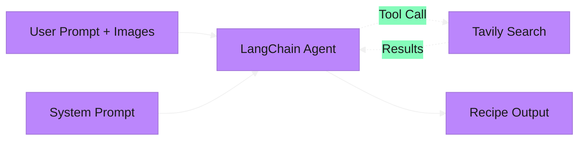

# multicook-agent


MultiCook Agent | A LangChain-driven multimodal agent leveraging vision-language models to analyze ingredient photos and dynamically synthesize tailored culinary instructions.

## Project Structure

```
multicook-agent/
├── pyproject.toml              # Project config + dev dependencies
├── .env.example                # Template environment variables
├── .env                        # Your local secrets (gitignored, create from .env.example)
├── .gitignore                  # Git ignore rules (includes .env, logs/, .venv/)
├── logs/                       # Rotating log files (gitignored)
├── src/multicook_agent/        # Python package
│   ├── __init__.py
│   ├── main.py                 # Entry point: configures logging, loads .env once, runs agent
│   ├── logging_config.py       # Shared logging config (stdout + logs/ file)
│   ├── model_config.py         # Multi-provider LLM factory (google_genai, groq, openai)
│   ├── prompt.py               # System and user prompt constants
│   ├── photo_decoder.py        # SelectionMode enum, image file picker, data URL conversion
│   ├── tools.py                # Tavily web_search tool
│   └── utils.py                # extract_text_content() utility
└── tests/
    ├── conftest.py             # Loads .env once for the test session
    ├── test_model_config.py    # Tests for multi-provider model factory
    ├── test_photo_decoder.py   # Tests for image selection/decoding
    ├── test_prompt.py          # Tests for prompt constants
    └── test_utils.py           # Tests for text extraction utility
```

## Architecture



### Flow Summary

1. **Inputs** — User prompt and ingredient image(s)
2. **System Prompt** — Chef persona instructions
3. **Agent** — LangChain agent orchestrates LLM + tools
4. **Tool** — Tavily searches for recipes online
5. **Output** — Markdown-formatted recipe rendered in terminal

## Prerequisites

- Python 3.13+
- [uv](https://github.com/astral-sh/uv) (recommended package manager)

## Setup

### 1. Clone or navigate to the project

```bash
cd c:\Learning\AICareerLab\LangChain\multicook-agent
```

### 2. Create your `.env` file

Copy `.env.example` to `.env` and fill in your API keys:

```bash
copy .env.example .env
```

Edit `.env` and set:

| Variable | Description | Required |
|----------|-------------|----------|
| `LLM_PROVIDER` | LLM provider: `google_genai`, `groq`, or `openai` | Yes |
| `GOOGLE_MODEL` | Gemini model name (default: `gemini-3.1-flash-lite`) | No |
| `GROQ_MODEL` | Groq model name (default: `qwen/qwen3.8-27b`) | No |
| `OPENAI_MODEL` | OpenAI model name (default: `gpt-4o-mini`) | No |
| `GOOGLE_API_KEY` | Google Gemini API key (from https://makersuite.google.com/app/apikey) | Yes if using `google_genai` |
| `GROQ_API_KEY` | Groq API key (from https://console.groq.com/keys) | Yes if using `groq` |
| `OPENAI_API_KEY` | OpenAI API key (from https://platform.openai.com/api-keys) | Yes if using `openai` |
| `TAVILY_API_KEY` | Tavily search API key (from https://app.tavily.com/) | Yes (for web search tool) |
| `MULTICOOK_LOG_LEVEL` | Log level: `DEBUG`, `INFO`, `WARNING`, `ERROR`, `CRITICAL` | No (default: `INFO`) |

### 3. Install dependencies

```bash
uv sync --group dev
```

This installs runtime dependencies and dev dependencies (pytest).

## Running the Agent

```bash
uv run python -m multicook_agent.main
```

Or:

```bash
uv run python src/multicook_agent/main.py
```

### What happens when you run it

1. `.env` is loaded once via `load_dotenv()`
2. Logging is configured — output goes to stdout and `logs/multicook_agent.log`
3. The LLM model is created based on your `LLM_PROVIDER` setting
4. A file picker opens for you to select an ingredient image (or falls back to console input)
5. The agent analyzes the image, searches for recipes using Tavily, and prints a Markdown-formatted response

### Supported LLM Providers

| Provider | Env Var `LLM_PROVIDER` | Default Model |
|----------|------------------------|---------------|
| Google Gemini | `google_genai` | `gemini-3.1-flash-lite` |
| Groq | `groq` | `qwen/qwen3.8-27b` |
| OpenAI | `openai` | `gpt-4o-mini` |

Override any model via its `<PROVIDER>_MODEL` env var (e.g. `GROQ_MODEL=mixtral-8x7b-32768`).

## Sample Output

Running with `sample_images/ingredients-1.jpg`:

```bash
uv run python -m multicook_agent.main --image sample_images/ingredients-1.jpg
```

```
Based on your ingredients, I'd recommend making a Caprese Salad with Salami and
Fried Eggs - this beautifully uses most of your ingredients:

Caprese Salad with Salami & Soft-Boiled Eggs

Ingredients (from your photos):

   • 2 eggs
   • 1 fresh mozzarella ball, sliced
   • 1 large tomato + cherry tomatoes, sliced
   • 2-3 slices salami
   • Fresh basil leaves
   • 2 tablespoons olive oil
   • 1 small shallot, thinly sliced
   • 1 garlic clove, minced
   • Pink salt and cracked peppercorns
   • Dried herbs (oregano)
   • Bay leaf (optional, for flavoring the oil)

Instructions:

 1 Prepare the oil: Warm 2 tablespoons of olive oil with the bay leaf, minced
    garlic, and a pinch of dried herbs for 2 minutes. Remove from heat and let
    cool slightly.
 2 Cook the eggs: Soft-boil the eggs for 6-7 minutes for runny yolks. Cool in
    ice water and peel.
 3 Assemble the salad:
     • Arrange tomato slices on a plate
     • Layer with mozzarella slices
     • Add salami slices
     • Place halved soft-boiled eggs on top
     • Scatter thinly sliced shallots
     • Tear fresh basil over the top
 4 Dress: Drizzle with the flavored olive oil, season with pink salt, cracked
    peppercorns, and a pinch of dried herbs.
 5 Serve: Enjoy immediately while the egg yolks are still runny.

This recipe uses nearly all your ingredients and creates a beautiful, flavorful
dish that's ready in about 20 minutes. The combination of fresh tomatoes,
creamy mozzarella, savory salami, and rich egg yolks is absolutely divine!
```

## Running Tests

```bash
uv run pytest tests/ -v
```

This runs all 30 unit tests across the utility, prompt, photo decoder, and model config modules.

## Logging

Logs are written to:

- **stdout** — colored console output
- **`logs/multicook_agent.log`** — rotating file (5 MB max, 3 backups)

Each log line includes timestamp, level, logger name, source file/line/function, process/thread IDs, and the message.

Set `MULTICOOK_LOG_LEVEL=DEBUG` in `.env` for verbose debug output.

## License

This project is licensed under the MIT License — see the [LICENSE](LICENSE) file for details.

### Summary

| Aspect | Details |
|--------|---------|
| **License** | MIT License |
| **Copyright** | 2026 Vidhaata Labs (Karthik Prabhu K) |
| **Permissions** | Commercial use, distribution, modification, private use |
| **Limitations** | No warranty, no liability |
| **Conditions** | Include copyright and license notice in copies |

### What this means

You are free to:

- **Use** this software for any purpose, including commercial projects
- **Copy** and distribute the software in source or compiled form
- **Modify** the software and create derivative works
- **Sublicense** and sell copies of the software

You must:

- Include the original copyright notice and this license in all copies or substantial portions of the software

The software is provided "as is", without warranty of any kind. The authors or copyright holders are not liable for any claims, damages, or other liability arising from the use of this software.